<div align="center">


<h1>银杏 · Yinxing Launcher</h1>

<p><strong>给长辈一个真正能用的 Android 首页</strong></p>

[](LICENSE)
[](https://yinxing.722688.xyz)
[](#下载安装)
[](https://github.com/bjfwan/yinxing/releases/tag/v2.3.0)
[](https://yinxing.722688.xyz)
[](https://github.com/bjfwan/yinxing/stargazers)

**大字、大图标只是起点。银杏真正想解决的是：长辈能不能稳定地找到家人、拨出电话，并在不同手机和软件版本上继续用下去。**

</div>

---

## 最新发布：v2.5.0（2026-11-01）

v2.5.0 是这次比较完整的一次更新：微信语音 / 视频来电自动接听转为正式能力，设置页做了信息架构重排，并把「家属配置清单」与「使用前检查」合并成一页；同时修掉了 v2.5.0 首次发布后真机反馈的接通不稳、开屏广告跳过、新功能角标不消失与挂断不返回首页，已用 release 包完成真机回归。

- 📞 **微信来电自动接听**（默认开启）：微信语音或视频来电时自动接听，只接一对一，群呼叫不接；设置里可单独关闭，接听倒计时 1～30 秒独立保存，不影响系统电话的设置；缺通知访问或无障碍时显示「未就绪」并引导，不会静默失败；
- 🔊 **通话声音辅助**（默认开启）：接听或拨打系统电话、接听微信来电、发起微信视频时自动把通话音量调到最大并尝试开免提；使用有线、蓝牙或 USB 耳机时保持原输出，不会强行外放；
- 🧾 **家属配置清单**：设置首页原来的「家属配置清单」和「使用前检查」合并成一个入口 + 一页清单；必要设置（联系人、电话权限）决定能不能交给老人，其余建议项只列缺的、已完成折叠；首次启动保持精简，配好必要项就能进首页，其余进去再配；
- 🧭 **设置页重排**：二级页从 11 个精简到 8 个；接听倒计时改为 3/5/8/10 秒常用档；外观模式行内直切；行高统一，不再有单行特别高；
- 📱 **首页内置卡片开关**：电话、微信视频两个内置卡片可分别隐藏；首页至少保留一张，关掉最后一张会被拦下提示；
- 🔋 **新增后台保活开关**：微信自动接听开启时可单独打开；
- 👤 **联系人「整卡可拨打」**：电话与视频通话联系人都可设置点整张卡片即拨打，管理态支持批量设置；
- ☎️ **系统电话稳定性**：规范化完整号码授权、拒接优先、服务统一倒计时，并加入脱敏通话诊断；
- 🚫 **开屏广告跳过**（实验性、可关闭）：补齐 H5 广告与左下角跳过区，只点「跳过」不点广告本体；
- 🧹 **清理缓存**：清完入口数字立即刷新；🌤️ **天气数据源**收敛为 Open-Meteo；💬 **设置页反馈入口**、🧾 **版本特性页**、🔔 **条款更新提醒**、🏠 **接完电话回到银杏**。

v2.5.0 代码基线（2026-11-01，versionCode 25）：`1188 tests, 0 failed, 0 skipped`（201 个测试类），Lint `0 errors`，Release 构建与 APK v2 签名校验通过；修复后的真机回归（微信语音 / 视频自动接听、挂断回首页、开屏广告）已完成。

[查看 v2.5.0 发布说明](docs/release/v2.5.0.md) · [查看 v2.4.1 发布说明](docs/release/v2.4.1.md) · [前往官网下载](https://yinxing.722688.xyz)

---

## 为什么做银杏

很简单：**我爷爷不会使用过于复杂的智能手机功能。**

现在的手机字体小、入口多，年轻人觉得顺手的操作，老人可能要翻好几层。市面上有不少老人桌面，但我还是想自己做一个给爷爷用的：简单、干净、够用，遇到问题也能知道问题出在哪里。

> **天行健，君子以自强不息。**

我相信，技术进步要向上突破，也要让普通人用得上。我是普通的计算机学生，我愿把所学变成责任，帮助更多人不被 AI 时代落下。借助新一代 AI，我更新了银杏，初衷不变：**让老人更简单地使用手机，让科技更有温度。**

---

## 银杏重点做了什么

银杏不是只把桌面图标放大。它把老人每天最常用的桌面、电话和微信视频做成主流程，并把最容易失败的微信自动操作单独做成了一套可观察、可切换、可诊断的执行系统。

### 1. 微信视频不是一条写死的点击路线

普通坐标脚本只要按钮位置、启动页面或微信版本稍有变化，整条流程就会中断。银杏目前使用的是 **语义页面识别 + 能力接口 + 轻量行为树**：

```text
观察当前页面 → 选择下一项能力 → 执行一次 → 验证结果 → 必要时局部换路
```

系统会识别微信首页、搜索页、联系人详情、聊天页和音视频菜单，而不是只记住“第几个位置”。当前能力包括：

- 启动微信并判断当前页面；
- 验证当前聊天是否为目标联系人；
- 从最近消息进入目标聊天；
- 从通讯录进入联系人详情；
- 搜索并打开目标联系人；
- 识别最近会话的 `[视频通话]` 记录并尝试最短路径；
- 从聊天信息页进入联系人详情；
- 打开音视频入口并选择视频通话；
- 确认真正进入视频呼叫页面；
- 页面置信度不足时等待、回到微信首页或安全停止。

当前有六条可组合入口路线：

| 路线 | 完整路径 |
|------|----------|
| 当前聊天 | 当前聊天页 → `+` → 视频通话 → 视频通话 |
| 历史视频记录 | 微信首页 → 最近消息 → 目标聊天 → 点击最近的历史视频通话记录 |
| 最近消息 | 微信首页 → 最近消息 → 目标聊天 → `+` → 视频通话 → 视频通话 |
| 通讯录 | 微信首页 → 通讯录 → 找到联系人 → 联系人详情 → 音视频通话 → 视频通话 |
| 搜索 | 微信首页 → 搜索 → 输入联系人 → 点击搜索结果 → 聊天页/联系人详情 → 音视频入口 → 视频通话 |
| 聊天信息 | 聊天页 → 右上角 → 聊天信息 → 点击头像 → 联系人详情 → 音视频通话 → 视频通话 |

这六条路线不是六段互不相干的坐标脚本，而是一套可以组合和换线的能力网络，也是银杏针对真实微信环境做的重点工作：

- **控件级最短路线**：每进入一个新页面，都重新比较当前可用入口的剩余操作数；即使原本准备走聊天信息长路线，发现历史视频记录后也会立即改走一键入口。
- **逐能力验证**：打开会话、确认联系人、进入通讯录、搜索、打开聊天信息、选择视频和确认呼叫分别记录状态，任何一步失败都能明确定位。
- **局部自动换线**：历史记录失败可切聊天菜单，最近消息失败可切通讯录，通讯录未找到可切搜索，聊天菜单失败可切聊天信息和联系人详情。
- **身份安全边界**：只有页面标题或联系人详情精确匹配目标联系人后才允许拨号，聊天正文里出现同名文字不能作为身份依据。
- **真实呼叫确认**：点击按钮不算成功；只有连续确认微信视频呼叫页面，或确认点击前后进入音频通信状态，银杏才报告视频通话已发起。
- **微信版本适配**：同时使用语义文字、控件资源 ID、页面类型、可见区域和示教校准；旧节点、越界节点和不可靠页面会被拒绝。

首页切换标签后必须连续两次确认目标标签已选中，才会点击列表，避免使用切换前的旧无障碍节点。历史记录没有真正进入微信视频页时，会自动退回聊天菜单路线。

每个能力只负责一件事，每进入一个新页面都会重新计算可用入口的剩余操作数：发现更短且未失败的安全入口就立即换线；某条路线失败时也可以从当前状态切换备用路线，不必盲目重放整条操作。通讯录仍会继续逐屏查找联系人，不会因为存在搜索路线就立即退出。

> 微信来电自动接听自 v2.5.0 起为正式能力（默认开启、可关闭，只接一对一）；**v2.4.1 及以前没有这个能力**。微信视频主动拨打仍是独立链路。

### 2. 示教不是录制坐标再回放

不同厂商、Android 版本和微信版本可能使用不同控件。银杏提供微信视频示教，让家属在本机人工完成一次流程，用来校准搜索、联系人、更多、音视频入口和视频确认等固定语义控件。

- 只保存资源 ID、控件类型、固定语义标签、相对位置和页面状态；
- 不保存联系人姓名、搜索内容、聊天文字、头像、截图、录音或视频；
- 未真正进入视频呼叫状态的示教不能成为可执行规则；
- 示教资料只用于对应设备和微信版本的受控兜底；
- 旧版任意步骤路径回放已经退出执行链路。

这不是让手机“记住用户点过哪里”，而是帮助现有语义能力适配当前设备上的控件差异。

### 3. 失败不再只显示一句“拨打失败”

微信自动化失败时，银杏会生成脱敏的结构化样本，记录：

- 执行到哪项能力；
- 识别到什么语义页面；
- 使用哪条路线；
- 页面置信度和窗口类型；
- 失败原因、状态指纹和能力时间线；
- 设备、Android 与微信版本信息。

诊断日志上报默认开启、可在设置随时关闭（关闭不影响任何本机功能）；上报的样本会进入项目开发者使用的私有维护后台。该后台不是银杏的公开功能，也不向普通用户或公众开放。开发者可以在后台将相同指纹的失败自动聚类，按能力、页面、路线、失败原因和处理状态筛选，查看一次完整能力链，并把样本标记为待处理、已复现、已修复或已忽略。

因此，陌生机型上的失败可以沉淀为明确的适配任务，而不是继续堆新的固定坐标。

### 4. 通话结束后，安全回到老人桌面

家属可以开启“通话结束返回首页”。它不是持续抢占前台，而是一次性的通话会话：

- 只处理从银杏发起的系统电话和微信视频；
- 必须先确认电话接通或进入微信视频页面；
- 挂断或取消后只返回一次银杏首页；
- 普通手动通话、来电和跌倒求助不会触发；
- 通话期间用户主动切到其他应用时，不会强行抢回桌面；
- 可在家属设置中完全关闭。

这让长辈打完电话后回到熟悉的首页，同时不影响手机的正常使用。

---

## 完整能力

### 老人每天直接使用

| 能力 | 已实现的细节 |
|------|--------------|
| 极简首页 | 时间、日期、农历、天气、电话、微信视频和家属选定应用集中展示 |
| 电话联系人 | 本地增删改查、系统通讯录导入、头像、列表/宫格布局、一键拨号 |
| 微信视频联系人 | 本地管理、搜索、置顶、头像、通话次数排序和一键主动拨打 |
| 应用内天气 | 天气详情、城市管理、当前位置、磁盘缓存；定位失败时保留原城市，不把老人丢到第三方页面 |
| 系统电话接听 | 默认电话角色、`InCallService`、联系人自动接听、可调倒计时和接听结果诊断 |
| 通话后回首页 | 系统电话与微信视频共用一次性返回会话，并识别用户主动离开 |
| 安全守护 | 可选跌倒检测、误报取消和呼叫家人；公开数据回放结果与真机效果分开说明 |

### 家属负责配置

- 第一次使用由家属完成必要设置（常用联系人、电话权限，默认桌面推荐），其余可以进首页后再配；
- 电话联系人、微信视频联系人和首页应用集中管理；
- 自动接听、倒计时、通话后回首页和紧急联系人均可单独设置；
- 字体支持跟随系统、标准、较大和特大；
- 首页应用支持按入口设置卡片大小（小=一行三个、中=一行两个、大=独占一行），也可统一大小；
- 首页图标大小、布局锁定和长按拖动开始时间可调整（长按整张卡片任意位置即可拖动排序）；联系人卡片可设置「整卡可拨打」（可批量设置）；
- 「家属配置清单」一页看全必要设置（联系人、电话权限）与使用前检查（通话、视频、后台保活共 7 项系统能力），只列缺项、已完成折叠；
- 支持浅色、深色和跟随系统；
- 低性能模式可减少非必要动画，照顾性能较弱的旧手机；
- 「清理缓存」只清本应用缓存和临时文件，带进度和可取消，不碰照片、联系人；清理完成后入口卡片上的可清理大小自动刷新，无可清理时显示「暂无可清理」；
- 「自动跳过开屏广告」默认保守识别“跳过”按钮、绝不点广告本身；
- 权限页会分别检查电话、通知、无障碍、电池、自启动和后台弹出能力；
- 默认桌面优先使用 Android 正式 Home 能力，厂商限制下提供明确引导和可选回退。

### 本地优先与隐私边界

- 无账号体系，联系人、桌面配置和适配资料优先保存在本机；
- 日志上传用于故障诊断，不作为广告画像或账号识别；
- “定位数据贡献”默认开启：真实定位成功时只匿名上报附近公共 WiFi/基站标识到公共定位库（beaconDB），可随时关闭；
- 微信示教是否上传由用户选择，本地保存不依赖上传成功；
- 微信来电自动接听只在本机内存中读取微信应用的通知和通话界面，用于判断是否为一对一来电；联系人姓名只用于与来电面板核对，不保存、不上传；结果性诊断上传服从“诊断日志上报”开关；
- 上传前过滤联系人、聊天文字和媒体内容；
- 不在老人机上运行大模型，主流程使用确定性的语义识别、状态验证和行为树，降低性能与不可控风险。

---

## 当前状态与边界

| 项目 | 状态 |
|------|------|
| 桌面、联系人、天气、家属设置 | 主流程已实现 |
| 微信视频主动拨打 | 能力树、语义识别、备用路线、示教校准和失败样本已接入，仍持续验证更多微信版本与机型 |
| 系统电话自动接听 | 已发布（v2.4 及以前）；v2.5.0 的稳定性修复（规范化完整号码授权、拒接优先、服务统一倒计时、脱敏通话诊断）已随 v2.5.0 发布；仍需真实 SIM 和多厂商 ROM 验证 |
| 首页内置卡片开关 | 已发布（v2.5.0：电话 / 微信视频内置卡可分别隐藏；首页至少保留一张卡片，关最后一张会拦下提示） |
| 通话声音辅助 | 已发布（v2.5.0：接听或拨打系统电话、接听微信来电、发起微信视频通话时把通话音量调到最大并尝试开免提；设置可关、默认开启；耳机真实输出待验收） |
| 微信接听后台保活 | 已发布（v2.5.0） |
| 跌倒检测 | 实验性安全能力，公开数据离线回放不代表所有真机准确率 |
| 自动跳过开屏广告 | 实验性能力，默认保守策略，只点“跳过”、不点广告 |
| 微信语音 / 视频来电自动接听 | 已发布（v2.5.0：vivo V1938CT 单机型连续 6 通语音/视频验证通过，首次发布后的接通不稳反馈已修复并完成真机回归；息屏/锁屏与多 ROM 仍未验证） |
| 通话结束返回银杏 | 已发布（能力自 v2.4 起已有；v2.5.0 补强返回判定：挂断后不停在微信聊天页，回到银杏首页更可靠） |
| 设置页反馈入口 | 已发布（v2.5.0） |
| 版本特性页 | 已发布（v2.5.0） |
| 条款更新提醒 | 已发布（v2.5.0：v2.4.1 及以前无此能力） |
| 远程协助、云同步、账号体系 | 当前不在范围内 |

工程基线：线上最新发布包 v2.5.0（2026-11-01，versionCode 25）为 `1188 tests, 0 failed, 0 skipped`（201 个测试类）、`lintRelease` `0 errors`，Release 构建与 APK v2 签名校验通过。修复后的真机回归（微信语音 / 视频自动接听、挂断回首页、开屏广告）已完成。

2026-11-01 验证边界：Node 发布 / 法务 / 站点契约 **31 项全通过**；真机在 vivo V1938CT / Android 10 / 微信 8.0.79 上连续多通微信语音 / 视频来电自动接通并在挂断后回到银杏首页（修复后回归）；**息屏 / 锁屏、多厂商 ROM、更多微信版本、耳机真实输出尚未验收**。

任何基于无障碍服务操作第三方应用的方案都会受到系统、微信版本和厂商 ROM 的影响。银杏的目标不是假装这些差异不存在，而是让流程能够识别状态、有限恢复，并在失败后留下可分析的证据。

### 下一步：2.6 版

下一版本（v2.6）准备重点着力优化权限相关问题：权限失效后的提醒与一步恢复、自启动 / 后台运行 / 电池优化的设置引导。无障碍权限被系统收回后第三方应用无法自行开启，所以方向是「尽快发现、一步恢复」。

敬请期待。使用中遇到任何问题，欢迎随时联系我们（联系方式见「参与项目」）。

---

## 界面

<div align="center">
  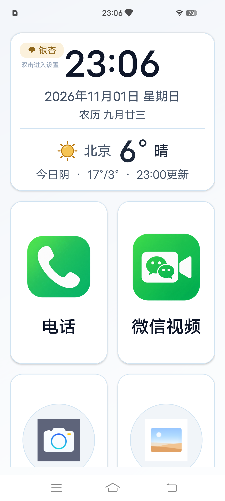
  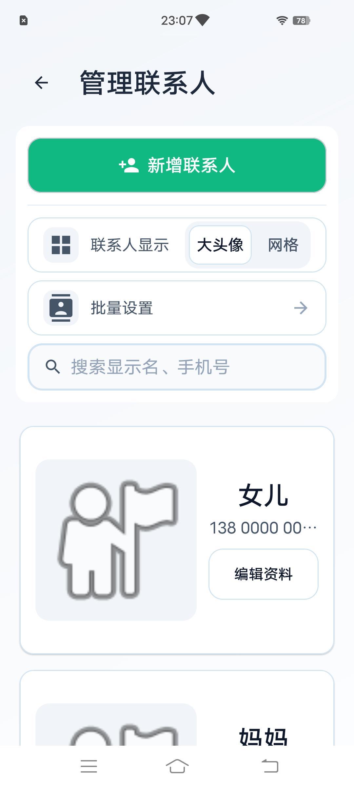
  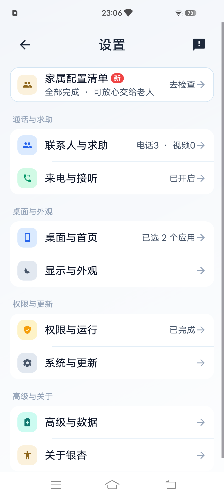
</div>
<div align="center">
  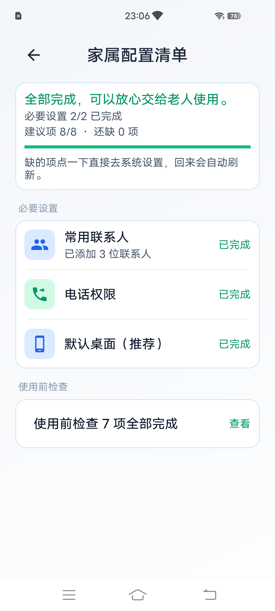
  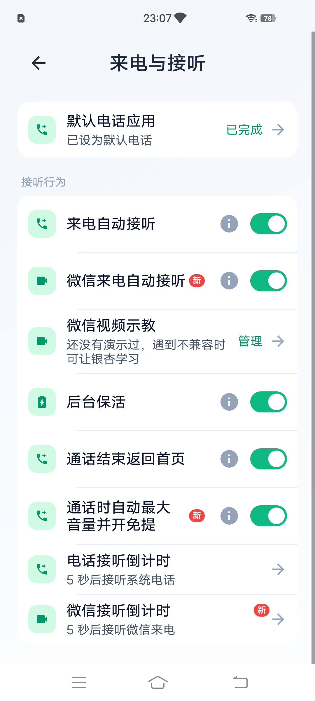
  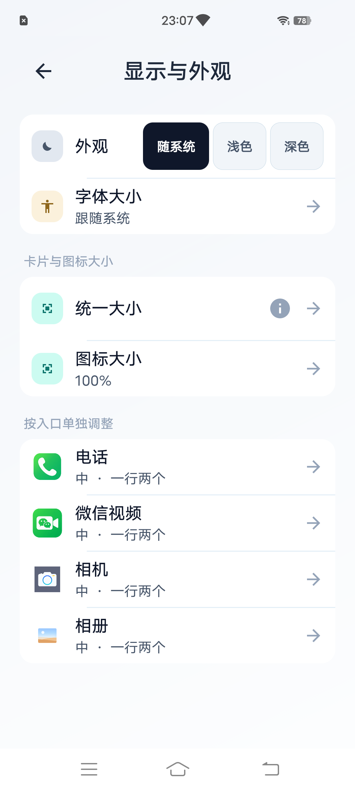
</div>

<details>
<summary><b>更多界面截图（点开查看）</b></summary>

<div align="center">
  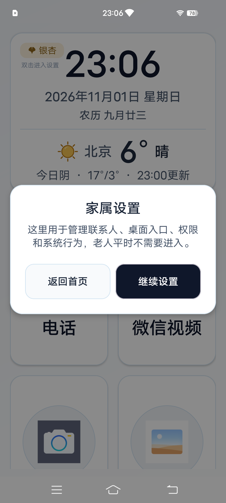
  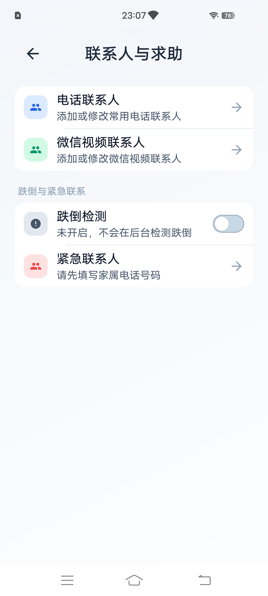
  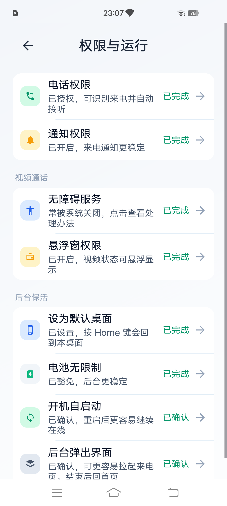
</div>
<div align="center">
  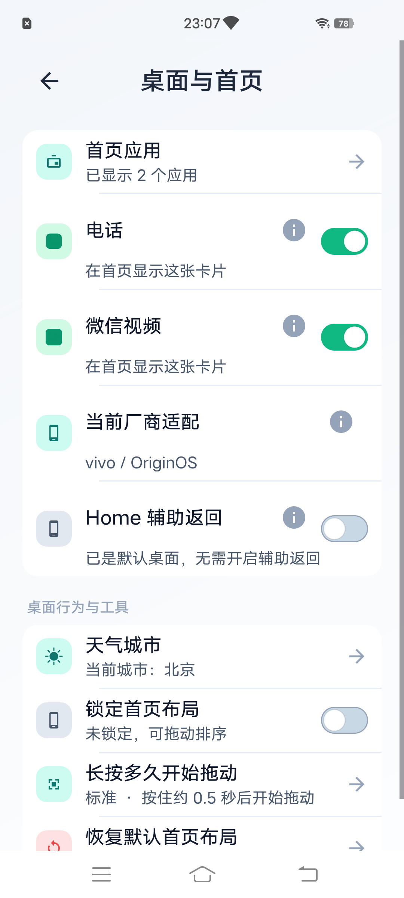
  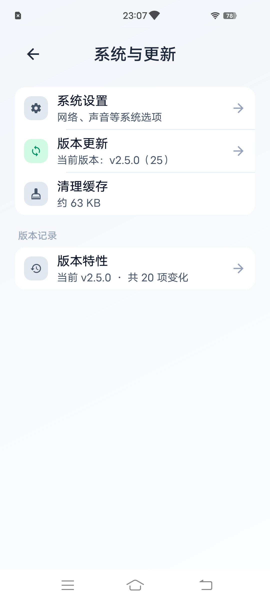
  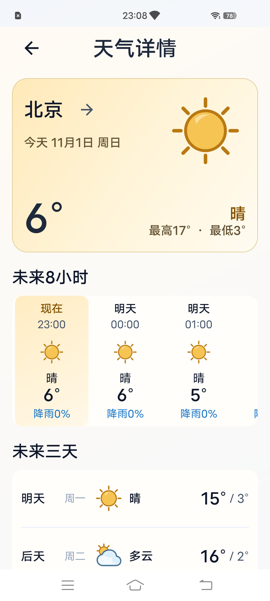
</div>

</details>

---

## 下载安装

<div align="center">

### [下载最新 APK](https://yinxing.722688.xyz)

线上最新发布：`v2.5.0`（versionCode 25，2026-11-01）

> 本仓库源码公开至 `v2.3.0`；`v2.4.0` 起仅提供 APK，详见下方「许可与开源范围」。

</div>

系统要求：Android 7.0（API 24）及以上。

首次安装建议由家属完成：

1. 安装 APK；
2. 打开银杏，按首次配置页完成必要设置（常用联系人 + 电话权限），默认桌面按提示一并设置；
3. 按 Home 键并选择“银杏”为默认桌面（如果前面没有设置）；
4. 添加常用电话和微信视频联系人；
5. 选择首页需要显示的应用；
6. 按实际需要开启通知、无障碍和后台权限，试拨一次电话和微信视频。

---

## 本地构建

环境要求：JDK 17+、Android SDK Platform 36，推荐使用 Android Studio。

```powershell
# 单元测试（项目 testBuildType = deviceTest，任务名是 testDeviceTestUnitTest）
.\gradlew.bat :app:testDeviceTestUnitTest --no-parallel

# Debug APK
.\gradlew.bat :app:assembleDebug --no-parallel

# Lint
.\gradlew.bat :app:lintDebug --no-parallel

# Release APK
.\gradlew.bat :app:assembleRelease --no-parallel
```

`build.bat` 会把 `JAVA_HOME` 固定为 `D:\Android\jbr`；本机没有该路径时，直接设置自己的 JDK 再调 `gradlew.bat` 即可：

```powershell
$env:JAVA_HOME = "<你的 JDK 17+ 路径>"
.\gradlew.bat :app:testDeviceTestUnitTest --no-parallel
```

Debug 输出目录：`app/build/outputs/apk/debug/`

---

## 工程结构

```text
yinxing/
├── app/
│   └── src/main/java/com/yinxing/launcher/
│       ├── feature/      # 首页、电话、视频、天气、设置、来电、跌倒、通话返回、首次配置
│       ├── data/         # 联系人、桌面、天气与设置数据
│       ├── automation/   # 微信示教与自动化领域模型、开屏广告跳过
│       ├── common/       # UI、日志、性能、权限、诊断等公共能力
│       └── (com.google.android.accessibility.selecttospeak)  # 无障碍执行层
├── benchmark/            # Baseline Profile 与 Macrobenchmark
├── docs/                 # 产品、架构、开发、隐私与发布文档
└── scripts/              # 文档与发布契约检查
```

微信无障碍执行层位于 `com.google.android.accessibility.selecttospeak`，业务入口、行为树、示教资料和诊断模型保持分层，避免把页面点击逻辑扩散到桌面业务中。

---

## 文档

> 公开仓只保留对外读者需要的文档；内部工程、自动化规格、测试与发布流程资料不对外发布。

| 文档 | 内容 |
|------|------|
| [文档总览](docs/README.md) | 公开文档索引与维护原则 |
| [当前功能状态](docs/product/current-feature-status.md) | 已发布能力、实验性边界与未交付范围 |
| [产品需求](docs/product/product-requirements.md) | 产品定位、已发布范围与非功能要求 |
| [设计规范](DESIGN.md) | UI 唯一设计契约：色彩、字号、间距、组件与提示八式 |
| [产品原则](PRODUCT.md) | 产品目标、原则与无障碍要求 |
| [首页兼容策略](docs/architecture/home-navigation-compatibility.md) | 默认桌面与厂商回退原则 |
| [许可说明](LICENSING.md) | 分版本许可与免费承诺 |
| 版本发布说明 | [v2.5.0](docs/release/v2.5.0.md)、[v2.4.1](docs/release/v2.4.1.md)、[v2.4.0](docs/release/v2.4.0.md)、[v2.3.0](docs/release/v2.3.0.md)、[v2.2.0](docs/release/v2.2.0.md)、[v2.1.1](docs/release/v2.1.1.md)、[v2.1.0](docs/release/v2.1.0.md)、[v2.0.0](docs/release/v2.0.0.md) |

---

## 参与项目

银杏面对的不是一台标准 Android 手机，而是不同品牌、系统版本、权限策略、字体设置和微信版本。欢迎提交真实设备上的成功或失败结果，也欢迎改进代码、文档、无障碍体验与适老设计。

提交日志、截图或设备信息前，请隐藏联系人、账号和电话号码等个人信息。

- [提交 Issue](https://github.com/bjfwan/yinxing/issues)
- [查看源码](https://github.com/bjfwan/yinxing)
- Email：[yinxing@722688.xyz](mailto:yinxing@722688.xyz)

---

## 许可与开源范围

**v2.4.0 起，银杏不再公开新版本源码；v2.3.0 及以前的源码继续按 GPL-3.0 公开，可自由获取、使用和修改。**

**先把话说清楚：闭源的只是源码，不是责任。** 下面这些承诺不会因为源码不再公开而改变：

- **APK 继续免费提供**：所有版本的安装包都从[官网](https://yinxing.722688.xyz)免费下载，应用内更新照常工作。
- **永不收费**：不收费、不设付费功能、不因为不付费削减任何能力；这一承诺与许可文件具有同等效力。
- **绝不出卖用户**：不出售个人信息，不做广告画像，不把任何数据用于与"让老人用好手机"无关的用途。
- **绝不采集**：通讯录内容、通话记录内容、短信、聊天文字与备注、照片 / 视频 / 录音 / 截图、精确 GPS 坐标、手机号、IMEI、IMSI、MAC、微信账号。这些内容在代码里没有对应的读取或上传路径，可以逐行核对。
- **隐私保护不会降级**：日志上报链路单独开源（见下），发布流程强制校验；闭源不意味着失去监督。
- **旧版本不受影响**：v2.3.0 及以前的源码与 [GNU General Public License v3.0](LICENSE)（`GPL-3.0-only`）许可继续有效，已经获取的副本和权利不受任何影响。
- **完整许可边界**见 [LICENSING.md](LICENSING.md)。

### 为什么新版本不再公开源码

做这个决定并不轻松，**也绝不是因为我们想藏起什么**。真正的原因在外部：

1. **开源被钻了空子**：全开源时期，实现细节被直接搬走、换皮发布，甚至被拿去针对银杏本身做干扰。被消耗的不是代码，而是那些真正需要它的人——最后连不上视频、打不出电话的，是家里的老人。**我们不能接受用老人的可用性，去补贴别人的流量和生意。**
2. **外部环境已经变了**：微信与各家手机系统频繁改版，一个公开的实现细节，第二天就可能被复制、被针对性绕过。适配成本与 2023 年开源时已不可同日而语。
3. **个人维护者扛不住两份消耗**：这是一个人的项目。源码公开意味着每天要处理"能不能适配某某 App"的定制诉求、审查外部提交、回应质疑——这些精力本该花在机型适配和稳定性上。**我们选择把有限的精力留给用户，而不是留给流程。**
4. **所以我们换一种方式接受监督**：把日志上报链路单独开源（见下）。**闭源不是拒绝被检验，而是把能公开的那部分做得更硬。**

### 日志上报链路单独开源

- 上报客户端、字段清单、脱敏器等 20 个源文件逐字节镜像在仓库的 [`diagnostics/`](diagnostics/) 目录；
- **每个版本同步更新**：`MANIFEST.json` 绑定 App 版本号、每个文件的 SHA-256 与当期 APK 的 SHA-256；发布流程强制校验，链路没有改动也会更新（只更新版本号与指纹），**让"这版偷偷改了"这种怀疑没有立足之地**；
- **不是主程序重新开源**：该目录不能独立编译，也不在仓根 GPL-3.0 的覆盖范围内，不授予再分发许可；
- **能力边界如实说明**：我们做到的是"公开代码与随包发布的上报逻辑一致、哈希可追溯"，不会假装能做到密码学意义上的"可验证一致"——APK 打包后无法从字节反推源码。**但一旦发现镜像与源码不一致，我们会立即修复并重新发布。**

### 日志上报的默认状态

- **默认开启**：诊断日志上报与定位数据贡献默认开启。机型与微信版本的差异只能靠真实设备样本发现，关闭默认上报等于放弃适配能力——**这是为了让老人用得上，不是为了收集你**；
- **可随时关闭**：设置 → 高级与数据 → 诊断日志上报 / 定位数据贡献，关闭后不影响任何本机功能；
- **会上报但先脱敏**：诊断日志中的五类文本字段在发送前统一脱敏。字段清单与脱敏规则以 [`diagnostics/README.md`](diagnostics/README.md) 为准；
- **绝不用于商业**：日志只服务于故障诊断与机型适配，不卖、不换、不做画像。

版权持有人有权许可的全部历史原创代码现同时按 `GPL-3.0-only` 提供；已经取得的旧许可证权利仍然有效。详见 [LICENSING.md](LICENSING.md)。

---

<div align="center">

**用代码，陪伴那些被时代遗忘的人。**


</div>
